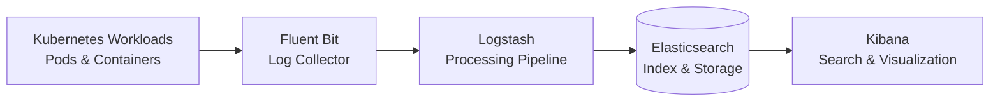
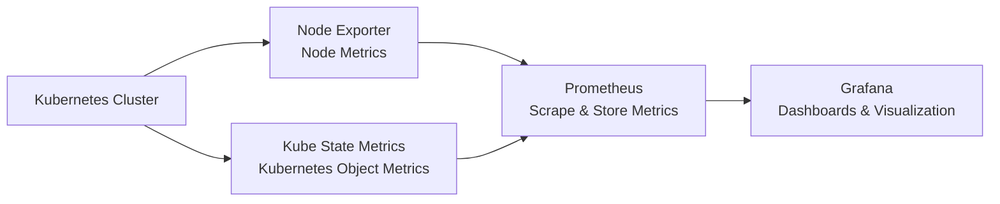

Kubernetes Observability & Monitoring Platform
Platform Observability Terpusat untuk Logging, Metrics Monitoring, dan
Incident Troubleshooting pada Kubernetes

01. Gambaran Umum Proyek
Kubernetes Observability & Monitoring Platform merupakan proyek
pembangunan platform observability pada lingkungan Kubernetes dengan
mengintegrasikan ELK Stack, Prometheus, dan Grafana.

Platform ini dirancang untuk menyediakan visibilitas terpusat terhadap
kondisi aplikasi dan infrastruktur Kubernetes melalui tiga area utama:
- Centralized Logging: mengumpulkan, memproses, menyimpan, dan
  mencari log aplikasi maupun container.
- Metrics Monitoring: mengumpulkan metrik kondisi cluster, node,
  dan workload Kubernetes.
- Visualization & Troubleshooting: menyajikan informasi melalui
  dashboard serta membantu investigasi ketika terjadi gangguan.
Implementasi juga mencakup simulasi incident, analisis log dan metrics,
identifikasi penyebab gangguan, serta validasi proses recovery.
Tujuan Proyek
- Membangun sistem centralized logging pada Kubernetes.
- Mengumpulkan dan menganalisis log aplikasi dan container.
- Mengimplementasikan monitoring resource Kubernetes.
- Membuat dashboard monitoring menggunakan Grafana.
- Mengintegrasikan logging dan metrics monitoring dalam satu platform
  observability.
- Melakukan simulasi incident dan troubleshooting.
- Mendokumentasikan proses implementasi beserta bukti pengujian.
  
02. Teknologi yang Digunakan
  Teknologi            Fungsi
  Kubernetes           Orkestrasi container dan pengelolaan workload
Elasticsearch        Penyimpanan, indexing, dan pencarian log
Logstash             Pemrosesan, transformasi, dan penerusan log
Fluent Bit           Pengumpulan dan pengiriman log dari node/container
Kibana               Pencarian, analisis, dan visualisasi log
Prometheus           Pengumpulan dan penyimpanan time-series metrics
Node Exporter        Eksposur metrics pada level node
Kube State Metrics   Eksposur metrics kondisi objek Kubernetes
Grafana              Visualisasi metrics dan pembuatan dashboard
Helm                 Manajemen instalasi aplikasi Kubernetes
Git & GitHub         Version control dan dokumentasi proyek
Komponen dan alur di atas mengikuti rancangan proyek. Detail versi,
metode instalasi, konfigurasi, dan status deployment dicatat
berdasarkan hasil implementasi aktual.

03. Arsitektur Sistem
Platform dibagi menjadi dua jalur observability yang saling melengkapi:
centralized logging dan metrics monitoring.
3.1 Arsitektur Centralized Logging
Alur pengumpulan dan pemrosesan log:

Kubernetes Workloads → Fluent Bit → Logstash → Elasticsearch → Kibana

Penjelasan alur:
1. Workload Kubernetes menghasilkan log dari aplikasi dan container.
2. Fluent Bit mengumpulkan log dari node/container.
3. Log dikirim ke Logstash untuk diproses dan disesuaikan dengan
   pipeline.
4. Elasticsearch menyimpan dan melakukan indexing terhadap data log.
5. Kibana digunakan untuk mencari, menganalisis, dan memvisualisasikan
   log.
Bukti arsitektur logging:
<!-- Tambahkan diagram arsitektur logging aktual pada direktori screenshots. -->{=html}

3.2 Arsitektur Metrics Monitoring
Alur pengumpulan metrics:

Kubernetes Cluster → Metrics Exporters → Prometheus → Grafana

Penjelasan alur:
1. Node Exporter menyediakan metrics pada level node.
2. Kube State Metrics menyediakan metrics mengenai kondisi objek
   Kubernetes.
3. Prometheus melakukan scraping terhadap target metrics yang
   dikonfigurasi.
4. PromQL digunakan untuk melakukan query dan analisis metrics.
5. Grafana menggunakan Prometheus sebagai data source untuk menampilkan
   dashboard monitoring.
Bukti arsitektur monitoring:
<!-- Tambahkan diagram arsitektur monitoring aktual pada direktori screenshots. -->{=html}

1.  Tahapan Implementasi

Checkpoint 01 --- Eksplorasi ELK Stack
Aktivitas:
- Memahami fungsi Elasticsearch sebagai penyimpanan dan indexing log.
- Memahami Logstash sebagai pemroses dan penerus log.
- Memahami Kibana sebagai antarmuka pencarian dan analisis log.
- Menguji proses indexing log.
- Melakukan pencarian log melalui Kibana.
Hasil implementasi:
Jelaskan hasil eksplorasi dan pengujian indexing berdasarkan output aktual.

Bukti pengujian:

Gambar berikut merupakan referensi visual ELK Stack yang disertakan pada
materi awal proyek. Ganti atau lengkapi dengan screenshot hasil
pengujian dari environment milik proyek.

Status: PENDING — perbarui setelah pengujian selesai

Checkpoint 02 --- Implementasi Centralized Logging
Aktivitas:
- Melakukan deployment Elasticsearch.
- Melakukan deployment Logstash.
- Melakukan deployment Fluent Bit.
- Melakukan deployment Kibana.
- Mengonfigurasi pipeline logging.
- Mengintegrasikan log Kubernetes ke sistem terpusat.
Hasil implementasi:
Catat komponen yang berhasil di-deploy, alur log yang terbentuk, serta indeks yang dihasilkan di Elasticsearch.

Bukti pengujian:

Gambar berikut merupakan referensi visual implementasi centralized
logging dari materi awal. Tambahkan screenshot aktual yang
memperlihatkan status komponen, aliran log, dan hasil pencarian log.

Status: PENDING — perbarui setelah pengujian selesai
Checkpoint 04 --- Implementasi Prometheus Metrics
Aktivitas:
- Melakukan deployment Prometheus.
- Melakukan deployment Node Exporter.
- Melakukan deployment Kube State Metrics.
- Mengonfigurasi scrape targets.
- Memeriksa status target monitoring.
- Melakukan pengujian query menggunakan PromQL.
Hasil implementasi:
Catat target yang berhasil di-scrape, jenis metrics yang tersedia, dan hasil query PromQL.

Bukti pengujian:

Gambar berikut merupakan referensi visual implementasi Prometheus.
Lengkapi dengan screenshot aktual halaman Targets dan hasil query
metrics.

Status: PENDING — perbarui setelah pengujian selesai

Checkpoint 05 --- Implementasi Grafana Dashboard
Aktivitas:
- Melakukan deployment Grafana.
- Menghubungkan Prometheus sebagai data source.
- Membuat dashboard monitoring Kubernetes.
- Menampilkan CPU utilization dan memory utilization.
- Memantau kondisi node dan pod.
Hasil implementasi:
Jelaskan dashboard yang berhasil dibuat, data source yang digunakan, dan metrics yang berhasil divisualisasikan.

Bukti pengujian:

Gambar berikut merupakan referensi visual dashboard Grafana dari materi
awal proyek. Tambahkan screenshot dashboard aktual yang menampilkan
metrics dari cluster.

Status: PENDING — perbarui setelah pengujian selesai
Checkpoint 06 --- Integrasi Observability
Aktivitas:
- Mengintegrasikan centralized logging dan metrics monitoring.
- Menghubungkan aplikasi dengan sistem observability.
- Memvalidasi aliran data logging.
- Memvalidasi pengumpulan metrics.
- Memastikan log dan metrics dapat digunakan untuk proses
  troubleshooting.
Hasil implementasi:
Jelaskan bagaimana log dan metrics berhasil digunakan secara bersamaan untuk memahami kondisi aplikasi dan cluster.

Bukti pengujian:

Gambar berikut merupakan referensi visual integrasi observability dari
materi awal. Ganti atau lengkapi dengan bukti aktual yang menunjukkan
aliran data logging dan metrics.

Status: PENDING — perbarui setelah pengujian selesai
Checkpoint 07 --- Simulasi Incident dan Troubleshooting
Aktivitas:
- Melakukan simulasi HTTP 500.
- Melakukan simulasi pod failure.
- Menguji perilaku container restart.
- Menganalisis metrics melalui Grafana.
- Menginvestigasi log melalui Kibana.
- Mengidentifikasi root cause.
- Melakukan recovery dan memvalidasi kondisi aplikasi.
Hasil implementasi:
Dokumentasikan incident yang benar-benar disimulasikan, gejala yang ditemukan, root cause, tindakan perbaikan, dan hasil recovery.
Laporan Incident
  Informasi         Hasil
  Jenis Incident    Isi berdasarkan simulasi
Waktu Kejadian    Isi waktu pengujian
Dampak            Isi dampak terhadap aplikasi/workload
Penyebab          Isi root cause setelah investigasi
Metode Deteksi    Grafana / Kibana / pemeriksaan Kubernetes
Solusi            Isi tindakan recovery
Status Recovery   Pending / Berhasil / Gagal

Bukti kondisi sebelum incident

Gambar berikut merupakan referensi kondisi workload sebelum simulasi
gangguan. Pastikan screenshot aktual menunjukkan jumlah replica dan
kondisi pod sebelum incident dimulai.

Bukti saat incident
<!-- Tambahkan screenshot kondisi pod, event, error HTTP, atau container restart. -->

Bukti investigasi
<!-- Tambahkan screenshot hasil analisis log Kibana dan metrics Grafana. -->

Bukti setelah recovery
<!-- Tambahkan screenshot kondisi aplikasi dan workload setelah recovery. -->

Catatan pengujian: Pada materi awal dicatat bahwa jumlah replica
tetap 2 ketika simulasi dilakukan. Verifikasi kembali kondisi tersebut
menggunakan output Kubernetes sebelum menjadikannya kesimpulan hasil
pengujian.

Status: PENDING — perbarui setelah simulasi dan recovery selesai
Checkpoint 08 --- Dokumentasi dan Finalisasi Proyek
Aktivitas:
- Menyelesaikan dokumentasi README.
- Membuat dan merapikan diagram arsitektur.
- Merapikan konfigurasi Kubernetes.
- Mengumpulkan screenshot evidence.
- Menyusun laporan pengujian.
- Melakukan final Git push.
- Menyusun artikel dokumentasi proyek di Medium.
Hasil implementasi:
Catat kelengkapan dokumentasi, konfigurasi final, dan commit terakhir repository.

Bukti pengujian:
<!-- Tambahkan screenshot halaman repository GitHub setelah finalisasi. -->

Status: PENDING — perbarui setelah seluruh dokumentasi selesai
1.  Hasil Pengujian
Tabel berikut digunakan sebagai checklist validasi keseluruhan platform.
Ubah status berdasarkan hasil pengujian aktual, bukan hanya berdasarkan
konfigurasi yang sudah dibuat.
                No. Skenario          Hasil yang       Status
                    Pengujian         Diharapkan       

                  1 Kubernetes        Seluruh node     Pending
                    Cluster Health    berada dalam     
                                      kondisi Ready    

                  2 Elasticsearch     Elasticsearch    Pending
                    Health            API dapat        
                                      diakses          

                  3 Log Collection    Log berhasil     Pending
                                      dikumpulkan oleh 
                                      Fluent Bit       

                  4 Log Processing &  Log berhasil     Pending
                    Indexing          diproses dan     
                                      diindeks         

                  5 Log Visualization Log dapat dicari Pending
                                      melalui Kibana   

                  6 Prometheus        Target           Pending
                    Targets           monitoring       
                                      berstatus UP     

                  7 Metrics           Metrics node dan Pending
                    Collection        objek Kubernetes 
                                      tersedia         

                  8 Grafana Dashboard Dashboard        Pending
                                      menampilkan data 
                                      dari Prometheus  

                  9 Incident          Gangguan         Pending
                    Simulation        berhasil         
                                      disimulasikan    
                                      dan diamati      

                 10 Troubleshooting   Log dan metrics  Pending
                                      membantu         
                                      investigasi      

                 11 Recovery Testing  Aplikasi kembali Pending
                                      ke kondisi yang  
                                      diharapkan       

1.  Struktur Repository
Struktur berikut merupakan rancangan pengelompokan source code,
konfigurasi, dan bukti implementasi. Sesuaikan nama direktori dan file
dengan struktur final repository.
kubernetes-observability-monitoring/
│
├── kubernetes/
│   ├── elasticsearch/
│   ├── logstash/
│   ├── fluent-bit/
│   ├── kibana/
│   ├── prometheus/
│   ├── node-exporter/
│   ├── kube-state-metrics/
│   └── grafana/
│
├── helm/
│
├── dashboards/
│
├── screenshots/
│   ├── architecture-logging.png
│   ├── architecture-monitoring.png
│   ├── kubernetes-cluster-validation.png
│   ├── kubernetes-resource-information.png
│   ├── checkpoint-01-environment-validation.png
│   ├── incident-during.png
│   ├── incident-investigation.png
│   ├── incident-recovery.png
│   └── repository-final.png
│
├── docs/
│
└── README.md
1.  Dokumentasi dan Screenshot Evidence
Seluruh bukti implementasi dan pengujian disimpan dalam direktori
screenshots/ dan dikelompokkan berdasarkan tahapan pengerjaan.

Dokumentasi screenshot digunakan untuk menunjukkan:
- Kondisi awal Kubernetes cluster dan resource environment.
- Proses deployment komponen ELK Stack.
- Pengumpulan, indexing, dan pencarian log.
- Status Prometheus scrape targets dan hasil query metrics.
- Dashboard monitoring Grafana.
- Integrasi logging dan metrics.
- Kondisi workload sebelum, saat, dan setelah incident.
- Hasil troubleshooting dan recovery.
- Kondisi akhir repository proyek.
Setiap gambar dilengkapi keterangan sesuai tahapan implementasi agar
proses verifikasi lebih mudah dilakukan.
09. Kesimpulan
Bagian kesimpulan ini perlu diselesaikan setelah seluruh checkpoint dan
skenario pengujian telah dijalankan.

Secara keseluruhan, proyek ini dirancang untuk membangun platform
observability terpusat pada lingkungan Kubernetes dengan menggabungkan
centralized logging menggunakan ELK Stack dan metrics monitoring
menggunakan Prometheus serta Grafana.

Melalui integrasi tersebut, administrator dapat mengumpulkan log
aplikasi dan container, memantau kondisi resource Kubernetes,
menganalisis gejala gangguan, serta melakukan investigasi dan validasi
recovery berdasarkan data observability.

Kesimpulan akhir mengenai keberhasilan implementasi, komponen yang
berjalan, dan hasil incident testing harus disesuaikan dengan bukti
pengujian aktual dari setiap checkpoint.

10. Informasi Repository
GitHub Repository:
RichardAkbar/kubernetes-observability-monitoring

Pengembang: Richard Akbar

Project: Kubernetes Observability & Monitoring Platform

Status: In Progress --- perbarui setelah seluruh checkpoint selesai.