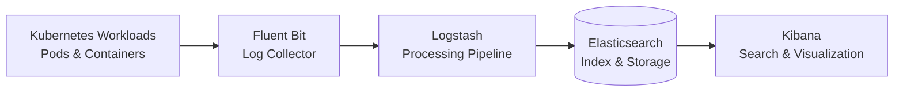
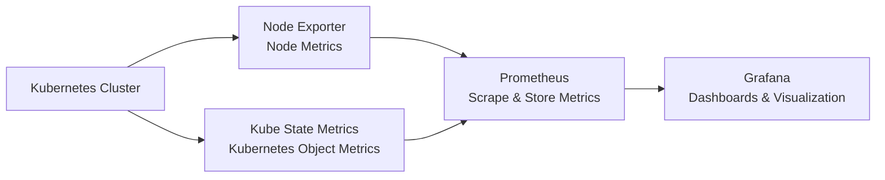
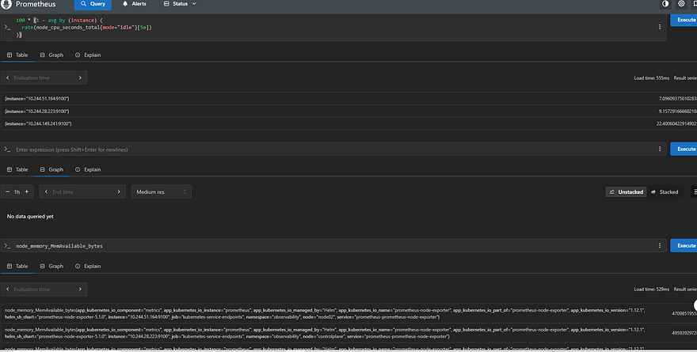
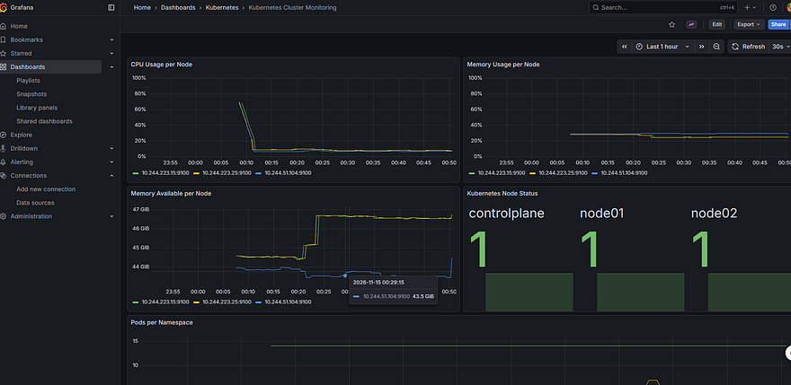
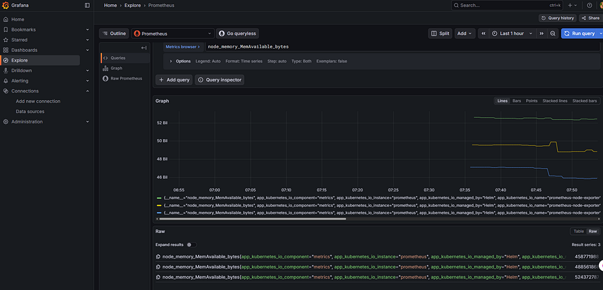

Kubernetes Observability & Monitoring Platform
Platform Observability Terpusat untuk Logging, Metrics Monitoring, dan
Incident Troubleshooting pada Kubernetes

01. Gambaran Umum Proyek
Kubernetes Observability & Monitoring Platform merupakan proyek
pembangunan platform observability pada lingkungan Kubernetes dengan
mengintegrasikan ELK Stack, Prometheus, dan Grafana.

Platform ini dirancang untuk menyediakan visibilitas terpusat terhadap
kondisi aplikasi dan infrastruktur Kubernetes melalui tiga area utama:
- Centralized Logging: mengumpulkan, memproses, menyimpan, dan
  mencari log aplikasi maupun container.
- Metrics Monitoring: mengumpulkan metrik kondisi cluster, node,
  dan workload Kubernetes.
- Visualization & Troubleshooting: menyajikan informasi melalui
  dashboard serta membantu investigasi ketika terjadi gangguan.
Implementasi juga mencakup simulasi incident, analisis log dan metrics,
identifikasi penyebab gangguan, serta validasi proses recovery.
Tujuan Proyek
- Membangun sistem centralized logging pada Kubernetes.
- Mengumpulkan dan menganalisis log aplikasi dan container.
- Mengimplementasikan monitoring resource Kubernetes.
- Membuat dashboard monitoring menggunakan Grafana.
- Mengintegrasikan logging dan metrics monitoring dalam satu platform
  observability.
- Melakukan simulasi incident dan troubleshooting.
- Mendokumentasikan proses implementasi beserta bukti pengujian.
  
02. Teknologi yang Digunakan
  Teknologi            Fungsi
  Kubernetes           Orkestrasi container dan pengelolaan workload
Elasticsearch        Penyimpanan, indexing, dan pencarian log
Logstash             Pemrosesan, transformasi, dan penerusan log
Fluent Bit           Pengumpulan dan pengiriman log dari node/container
Kibana               Pencarian, analisis, dan visualisasi log
Prometheus           Pengumpulan dan penyimpanan time-series metrics
Node Exporter        Eksposur metrics pada level node
Kube State Metrics   Eksposur metrics kondisi objek Kubernetes
Grafana              Visualisasi metrics dan pembuatan dashboard
Helm                 Manajemen instalasi aplikasi Kubernetes
Git & GitHub         Version control dan dokumentasi proyek
Komponen dan alur di atas mengikuti rancangan proyek. Detail versi,
metode instalasi, konfigurasi, dan status deployment dicatat
berdasarkan hasil implementasi aktual.

03. Arsitektur Sistem
Platform dibagi menjadi dua jalur observability yang saling melengkapi:
centralized logging dan metrics monitoring.
3.1 Arsitektur Centralized Logging
Alur pengumpulan dan pemrosesan log:

Kubernetes Workloads → Fluent Bit → Logstash → Elasticsearch → Kibana

Penjelasan alur:
1. Workload Kubernetes menghasilkan log dari aplikasi dan container.
2. Fluent Bit mengumpulkan log dari node/container.
3. Log dikirim ke Logstash untuk diproses dan disesuaikan dengan
   pipeline.
4. Elasticsearch menyimpan dan melakukan indexing terhadap data log.
5. Kibana digunakan untuk mencari, menganalisis, dan memvisualisasikan
   log.
Bukti arsitektur logging:
<!-- Tambahkan diagram arsitektur logging aktual pada direktori screenshots. -->{=html}

3.2 Arsitektur Metrics Monitoring
Alur pengumpulan metrics:

Kubernetes Cluster → Metrics Exporters → Prometheus → Grafana

Penjelasan alur:
1. Node Exporter menyediakan metrics pada level node.
2. Kube State Metrics menyediakan metrics mengenai kondisi objek
   Kubernetes.
3. Prometheus melakukan scraping terhadap target metrics yang
   dikonfigurasi.
4. PromQL digunakan untuk melakukan query dan analisis metrics.
5. Grafana menggunakan Prometheus sebagai data source untuk menampilkan
   dashboard monitoring.
Bukti arsitektur monitoring:
<!-- Tambahkan diagram arsitektur monitoring aktual pada direktori screenshots. -->{=html}

1.  Tahapan Implementasi

Checkpoint 01 --- Eksplorasi ELK Stack
Aktivitas:
- Memahami fungsi Elasticsearch sebagai penyimpanan dan indexing log.
- Memahami Logstash sebagai pemroses dan penerus log.
- Memahami Kibana sebagai antarmuka pencarian dan analisis log.
- Menguji proses indexing log.
- Melakukan pencarian log melalui Kibana.
Hasil implementasi:
Jelaskan hasil eksplorasi dan pengujian indexing berdasarkan output aktual.

Bukti pengujian:

Gambar berikut merupakan referensi visual ELK Stack yang disertakan pada
materi awal proyek. Ganti atau lengkapi dengan screenshot hasil
pengujian dari environment milik proyek.

Status: PENDING — perbarui setelah pengujian selesai

Checkpoint 02 --- Implementasi Centralized Logging
Aktivitas:
- Melakukan deployment Elasticsearch.
- Melakukan deployment Logstash.
- Melakukan deployment Fluent Bit.
- Melakukan deployment Kibana.
- Mengonfigurasi pipeline logging.
- Mengintegrasikan log Kubernetes ke sistem terpusat.
Hasil implementasi:
Catat komponen yang berhasil di-deploy, alur log yang terbentuk, serta indeks yang dihasilkan di Elasticsearch.

Bukti pengujian:

Gambar berikut merupakan referensi visual implementasi centralized
logging dari materi awal. Tambahkan screenshot aktual yang
memperlihatkan status komponen, aliran log, dan hasil pencarian log.

Checkpoint 04 --- Implementasi Prometheus Metrics
Aktivitas:
- Melakukan deployment Prometheus.
- Melakukan deployment Node Exporter.
- Melakukan deployment Kube State Metrics.
- Mengonfigurasi scrape targets.
- Memeriksa status target monitoring.
- Melakukan pengujian query menggunakan PromQL.
Hasil implementasi:
Catat target yang berhasil di-scrape, jenis metrics yang tersedia, dan hasil query PromQL.

Bukti pengujian:

Gambar berikut merupakan referensi visual implementasi Prometheus.
Lengkapi dengan screenshot aktual halaman Targets dan hasil query
metrics.

Checkpoint 05 --- Implementasi Grafana Dashboard
Aktivitas:
- Melakukan deployment Grafana.
- Menghubungkan Prometheus sebagai data source.
- Membuat dashboard monitoring Kubernetes.
- Menampilkan CPU utilization dan memory utilization.
- Memantau kondisi node dan pod.
Hasil implementasi:
Jelaskan dashboard yang berhasil dibuat, data source yang digunakan, dan metrics yang berhasil divisualisasikan.

Bukti pengujian:

Gambar berikut merupakan referensi visual dashboard Grafana dari materi
awal proyek. Tambahkan screenshot dashboard aktual yang menampilkan
metrics dari cluster.

Checkpoint 06 --- Integrasi Observability
Aktivitas:
- Mengintegrasikan centralized logging dan metrics monitoring.
- Menghubungkan aplikasi dengan sistem observability.
- Memvalidasi aliran data logging.
- Memvalidasi pengumpulan metrics.
- Memastikan log dan metrics dapat digunakan untuk proses
  troubleshooting.
Hasil implementasi:
Jelaskan bagaimana log dan metrics berhasil digunakan secara bersamaan untuk memahami kondisi aplikasi dan cluster.

Bukti pengujian:

Gambar berikut merupakan referensi visual integrasi observability dari
materi awal. Ganti atau lengkapi dengan bukti aktual yang menunjukkan
aliran data logging dan metrics.

### Hasil Implementasi

Simulasi incident dilakukan dengan menghapus salah satu Pod dari Deployment `incident-test` yang dikonfigurasi menggunakan dua replica.

Sebelum simulasi dimulai, kedua Pod berada dalam kondisi `Running` dengan status `1/1 Ready`. Salah satu Pod kemudian dihapus secara manual untuk menguji kemampuan Kubernetes dalam mempertahankan jumlah replica yang diinginkan.

Setelah penghapusan dilakukan, ReplicaSet mendeteksi bahwa jumlah Pod tidak sesuai dengan konfigurasi yang ditentukan. Kubernetes kemudian membuat Pod pengganti secara otomatis.

Hasil validasi menunjukkan bahwa jumlah workload kembali menjadi dua Pod dengan kondisi `1/1 Running`. Hal ini membuktikan bahwa mekanisme self-healing Kubernetes berjalan dengan baik dalam menangani simulasi kegagalan Pod.

### Laporan Incident

| Informasi | Hasil Pengujian |
|---|---|
| Jenis Incident | Pod Failure – Manual Pod Deletion |
| Waktu Kejadian | 18 November 2026 |
| Dampak | Salah satu Pod dihapus sehingga jumlah Pod aktif berkurang sementara |
| Penyebab | Penghapusan Pod secara manual untuk menguji mekanisme self-healing |
| Metode Deteksi | Pemeriksaan Kubernetes menggunakan kubectl dan Kubernetes Events |
| Solusi | ReplicaSet membuat Pod pengganti secara otomatis |
| Status Recovery | Berhasil |

### Bukti Kondisi Sebelum Incident

Screenshot menunjukkan dua Pod pada Deployment `incident-test` dalam kondisi `1/1 Running` sebelum simulasi gangguan dilakukan. Kedua Pod berjalan pada node yang berbeda, yaitu `node01` dan `node02`.

### Bukti Saat Incident

Simulasi dilakukan dengan menghapus Pod `incident-test-6998d6dc-d2mvl` menggunakan perintah `kubectl delete pod`. Penghapusan tersebut digunakan untuk menguji respons Kubernetes ketika salah satu Pod mengalami kegagalan.

### Bukti Investigasi

Kubernetes Events menunjukkan aktivitas penghapusan Pod, proses pembuatan Pod baru oleh ReplicaSet, serta penjadwalan dan proses startup container. Hasil pemeriksaan digunakan untuk memastikan bahwa mekanisme recovery berjalan sesuai konfigurasi Deployment.

### Bukti Setelah Recovery

Setelah proses recovery, Kubernetes berhasil membuat Pod pengganti `incident-test-6998d6dc-nlnvc`. Hasil pemeriksaan menunjukkan dua Pod kembali berada dalam kondisi `1/1 Running` dan tersebar pada `node01` serta `node02`.

### Catatan Pengujian

Berdasarkan hasil pengujian, jumlah replica berhasil dipertahankan sebanyak dua Pod setelah proses recovery selesai. Pengujian ini membuktikan mekanisme self-healing Kubernetes melalui ReplicaSet ketika terjadi penghapusan Pod secara manual.

Kesimpulan

Project Kubernetes Observability & Monitoring bertujuan membangun sistem observability untuk memantau kondisi cluster Kubernetes, mengumpulkan metrics, mengelola log secara terpusat, serta membantu proses troubleshooting ketika terjadi gangguan pada workload.

Dalam project ini, dua komponen utama observability diimplementasikan:

1. Metrics Monitoring menggunakan Prometheus dan Grafana

Prometheus digunakan untuk mengumpulkan dan menyimpan metrics dari Kubernetes melalui Node Exporter dan Kube State Metrics. Metrics tersebut dapat dianalisis menggunakan PromQL dan divisualisasikan melalui Grafana Dashboard untuk memantau penggunaan CPU, memory, kondisi node, serta workload Kubernetes.

2. Centralized Logging menggunakan ELK Stack

Fluent Bit digunakan untuk mengumpulkan log container dari setiap node Kubernetes dan meneruskannya ke Logstash. Logstash memproses log sebelum dikirim ke Elasticsearch untuk penyimpanan dan indexing. Selanjutnya, Kibana digunakan untuk melakukan pencarian, filtering, dan analisis log secara terpusat.

3. Incident Simulation dan Troubleshooting

Pengujian dilakukan untuk memahami bagaimana Kubernetes menangani gangguan pada workload. Salah satu simulasi yang berhasil dilakukan adalah Pod Failure dengan menghapus salah satu Pod secara manual. Hasil pengujian menunjukkan ReplicaSet secara otomatis membuat Pod pengganti sehingga jumlah replica kembali menjadi dua dan seluruh Pod berstatus Running.

